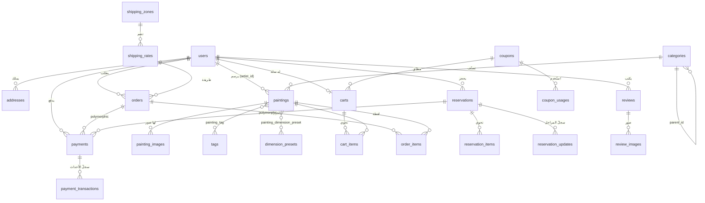

# مخطّط قاعدة البيانات

MySQL 8 · `utf8mb4_unicode_ci` · كل الجداول عبر هجرات Laravel.

## الرسم



## قرارات ثابتة

**المبالغ `decimal(10,2)`** لا `float`. الفاصلة العائمة تُنتج `0.1 + 0.2 ≠ 0.3`،
وهو فرق يظهر في الفواتير ويتراكم في التقارير.

**المدفوعات متعددة الأشكال (`morphs('payable')`).** الدفعة قد تخصّ طلباً أو
حجزاً، والحجز قد يحمل دفعتين (عربون ثم متبقٍّ) — ولذلك المبلغ في `payments`
لا في `reservations`.

**`payment_transactions` سجلّ لا يُعدَّل** (`UPDATED_AT = null`). يحفظ حمولة كل
حدث وارد من المزوّد بصيغتها الخام مع نتيجة التحقق من التوقيع. هو الدليل عند
أي نزاع محاسبي، وهو ما يسمح بإعادة معالجة خطّاف فشل.

**لقطات مجمّدة داخل `order_items`** — العنوان والرمز والسعر والمقاس والصورة.
تغيير سعر لوحة لاحقاً يجب ألّا يغيّر فاتورة صدرت. ولذلك `painting_id` هنا
`nullOnDelete` لا `cascade`.

**عنوان الشحن مُجمَّد في `orders`** لا مرتبطاً بجدول العناوين، للسبب نفسه:
تعديل الزبون لعنوانه بعد الشحن يجب ألّا يغيّر عنوان طلب أُرسل فعلاً.

**الحذف الناعم** على `users` و`paintings` و`orders` و`reservations` و`categories`
و`coupons` و`reviews` — كلها مشار إليها من سجلات محاسبية.

**`orders.user_id` بـ `restrictOnDelete`**: لا يُحذف حساب له طلبات. لوحة
الإدارة تعرض «عطّله بدلاً من ذلك».

## الفهارس

مركّبة على مسارات التصفية الفعلية لا على كل عمود:

```
paintings (painting_type, availability, price)
paintings (category_id, published_at)
paintings (is_featured, published_at)
orders (user_id, created_at) · orders (status, created_at)
reservations (artist_id, status) · reservations (status, created_at)
payments (status, created_at) · payments (gateway_payment_id)
payment_transactions (gateway, gateway_reference)
```

قيود التفرّد: `paintings.slug`، `paintings.sku`، `categories.slug`،
`coupons.code`، `orders.order_number`، `reservations.reservation_number`،
`payments.payment_number`، `users.email`، `users.phone`،
`cart_items (cart_id, painting_id)`، `wishlist_items (user_id, painting_id)`،
`reviews (painting_id, user_id)`.

## الجداول

| المجموعة | الجداول |
|----------|---------|
| الهوية | `users` · `roles` · `permissions` · `model_has_roles` · `model_has_permissions` · `role_has_permissions` · `personal_access_tokens` · `addresses` |
| الكتالوج | `categories` · `paintings` · `painting_images` · `tags` · `painting_tag` · `dimension_presets` · `painting_dimension_preset` |
| التجارة | `carts` · `cart_items` · `wishlist_items` · `orders` · `order_items` · `coupons` · `coupon_usages` |
| الحجوزات | `reservations` · `reservation_items` · `reservation_updates` |
| الدفع | `payments` · `payment_transactions` |
| الشحن | `shipping_zones` · `shipping_rates` |
| المحتوى | `banners` · `settings` · `reviews` · `review_images` · `newsletter_subscribers` |
| النظام | `notifications` · `activity_log` · `jobs` · `cache` · `sessions` |
